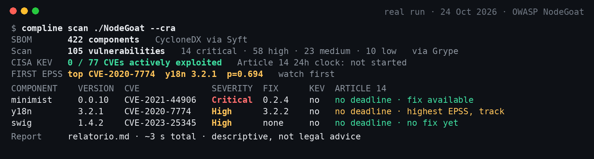
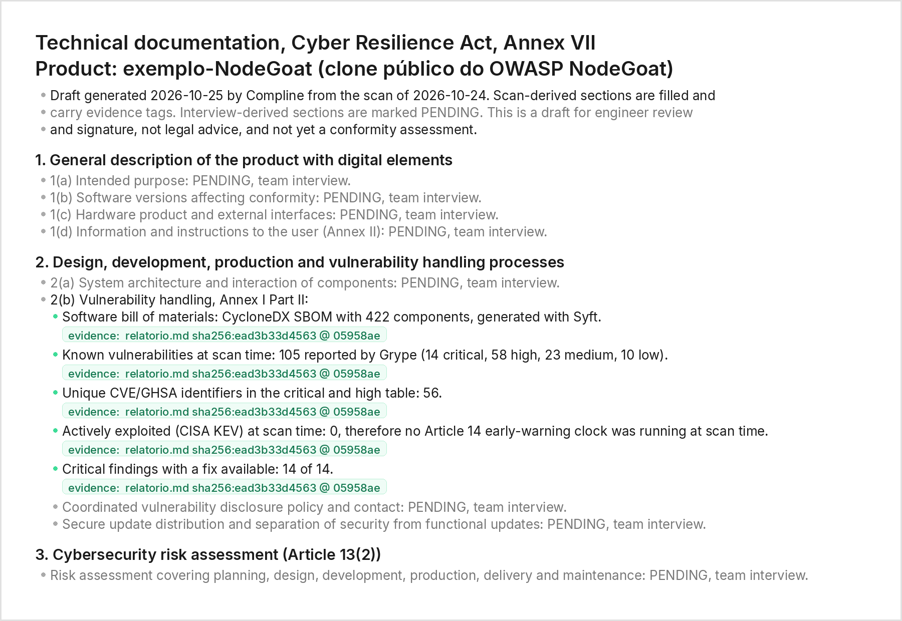

# Compline

**Compline writes and maintains the Cyber Resilience Act technical file for a manufacturer, from its repository.**

[](https://github.com/FranciscoCascalheira/compline/actions/workflows/ci.yml)
&nbsp;MIT licensed &nbsp;·&nbsp; early stage &nbsp;·&nbsp; not legal advice

From 11 December 2027, every product with digital elements sold in the EU needs a cybersecurity technical file (CRA, Regulation (EU) 2024/2847, Annex VII) to keep its CE mark. Reporting duties under Article 14 already apply since 11 September 2026. Today that file is written by hand, by consultants, once. Scanners list components and flaws, and nobody keeps the two in sync.

Compline closes that loop:

1. **Scan** the repository: CycloneDX SBOM, known flaws, CISA KEV and FIRST EPSS.
2. **Interview** the team: 10 to 15 questions on architecture, updates and support period.
3. **Draft** the Annex VII file with the scan as evidence. Every claim points at the artefact and commit it came from.
4. **Review and sign**: an engineer signs. On every release the file is regenerated, and the diff is the audit trail.

## Status

| Step | State | In this repo |
| --- | --- | --- |
| Scan: SBOM, CVEs, KEV, EPSS | Working | [`scan.mjs`](./scan.mjs), real run in [`relatorio.md`](./relatorio.md) |
| Annex VII draft from the scan | First version | [`annex7.py`](./annex7.py), output in [`annex-vii-draft.md`](./annex-vii-draft.md), tests in [`test_annex7.py`](./test_annex7.py) |
| Agent interview for the remaining sections | Building, 27 Oct to 14 Dec 2026 | |
| Regeneration and diff on every release | Building | |
| First technical file for a manufacturer | Target 14 Dec 2026 | |

## The proof

A real scan of OWASP NodeGoat, a deliberately outdated demo app, run on 24 October 2026:



- **422** components in the SBOM.
- **105** known vulnerabilities: 14 critical, 58 high, 23 medium, 10 low.
- **77** unique CVEs checked against the CISA KEV catalogue (version 2026.10.23). None was actively exploited at run time, so no Article 14 clock was running.
- Highest EPSS score in that run: `CVE-2020-7774` (y18n), 0.69377.
- About 3 seconds for SBOM plus scan.

The next day, `annex7.py` turned that report into the first draft of the technical file:



- **9** claims filled from the scan, each tagged with the source file, its SHA-256 and the commit.
- **13** items that depend on the team interview, marked `PENDING` rather than invented.
- All **8** Annex VII sections, in the order of the regulation.

These numbers describe NodeGoat, not a customer product.

## Run it

You need Node.js 18 or later, Python 3.10 or later, and [Syft](https://github.com/anchore/syft) and [Grype](https://github.com/anchore/grype) on your `PATH` (or set `SYFT_BIN` and `GRYPE_BIN`). The scan queries the public CISA KEV feed and the FIRST EPSS API, so it needs internet access.

```bash
git clone https://github.com/FranciscoCascalheira/compline.git
cd compline

# a target to scan: OWASP NodeGoat is what the proof used
git clone https://github.com/OWASP/NodeGoat.git exemplo-NodeGoat

npm run scan     # writes sbom.cdx.json, vulns.json and relatorio.md
npm run annex    # writes annex-vii-draft.md from relatorio.md
npm test         # checks the draft against the report
```

To scan another target, set `TARGET_DIR=/path/to/repo`. Generated SBOM, scan and feed files are git-ignored because they are large, dated or regenerable. The report text is in Portuguese, the language of the first proof; the technical file is in English.

## Files

| File | What it is |
| --- | --- |
| `scan.mjs` | Runs Syft and Grype, cross-checks every CVE with CISA KEV and FIRST EPSS, and writes `relatorio.md`. Node.js built-ins only. |
| `relatorio.md` | The real report from the 24 October 2026 NodeGoat run. |
| `annex7.py` | Drafts the CRA Annex VII technical file from the report, with evidence tags. Python standard library only. |
| `annex-vii-draft.md` | The draft generated on 25 October 2026. |
| `test_annex7.py` | Checks that the draft has every Annex VII section, that every scan claim carries the report hash, that the numbers match the report, and that interview sections stay `PENDING`. |

## Limitations

- This is an early technical proof, not a conformity assessment and not legal advice. Whether a product is in CRA scope, and whether an Article 14 deadline has started, needs case-by-case analysis.
- The draft fills only what the scan can prove. Architecture, risk assessment, support period, standards and the declaration of conformity wait for the interview and an engineer's signature.
- No deduplication of repeated component and CVE pairs across versions, and no normalisation between GitHub Security Advisory and NVD severities.
- EPSS estimates the probability of future exploitation. Only KEV membership is treated as a proxy for "actively exploited".
- See section 5 of `relatorio.md` for the full list as of the last run.

## Team

- **Francisco Cascalheira**, founder and engineer. FEUP, Informatics and Computing Engineering. Head of Product at Unilinkr.
- **Rian Vilares**, co-founder, industry. FEUP, Mechanical Engineering.

## License

MIT, see [`LICENSE`](./LICENSE).
